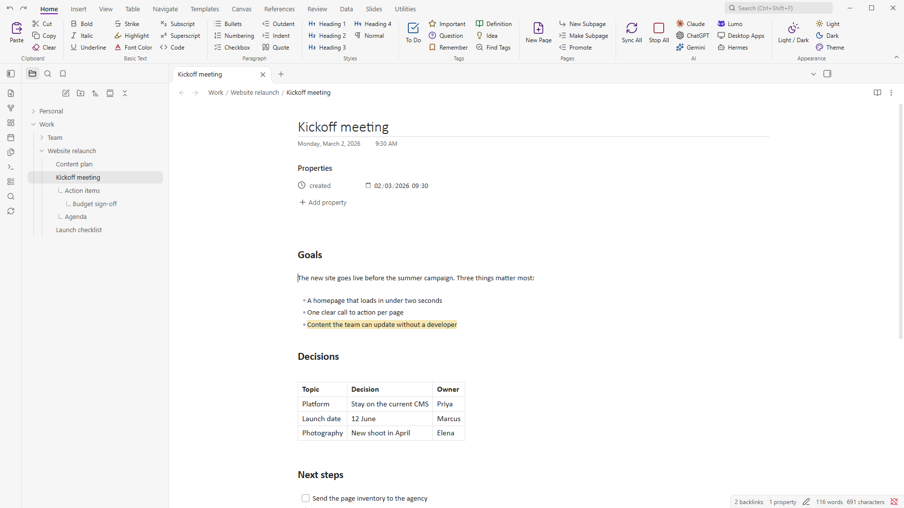
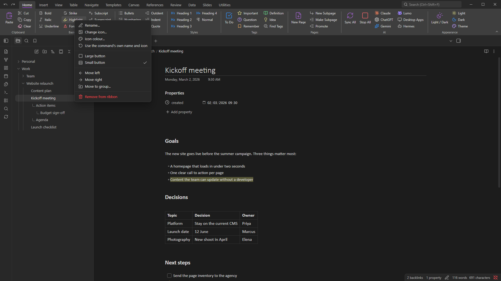
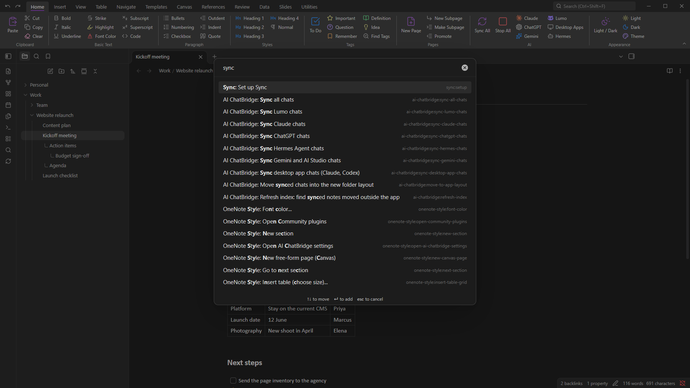
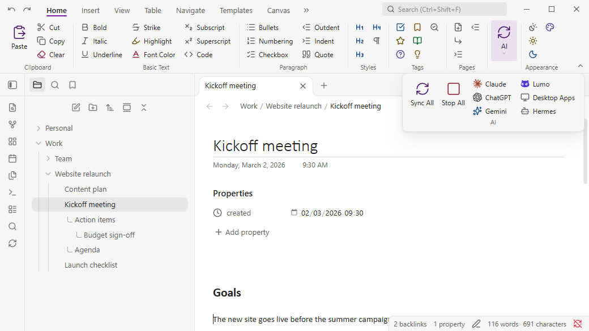
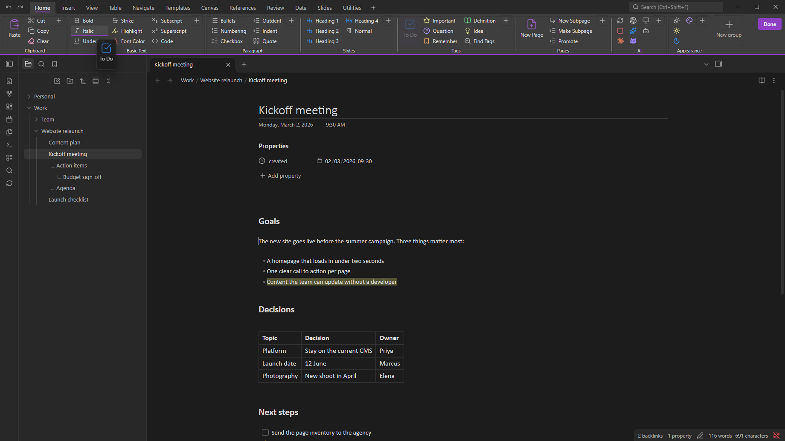

# OneNote Style

**The ribbon you already know, in your Obsidian vault.** OneNote Style puts Office-style **tabs**, **groups** and **buttons** above your notes - **Home**, **Insert**, **View** and nine more tabs, filled and ready - so you click instead of remembering commands. Any command of Obsidian or of your other plugins can be a button, and a right-click changes anything. Note tags and subpages come along too.

**Part of the [Sundowna Second Brain Suite](#part-of-the-sundowna-second-brain-suite)** - an easy, low-friction second brain in Obsidian, in the spirit of [Karpathy's LLM wiki](https://gist.github.com/karpathy/442a6bf555914893e9891c11519de94f). The other pieces: [AI ChatBridge](https://github.com/Sundowna/obsidian-ai-chatbridge) (all your AI chats in your vault) and the [OneNote Style theme](https://github.com/Sundowna/obsidian-onenote-theme) (the look you already know).



## Why

Obsidian is powerful, and most of that power sits behind a command palette and hotkeys. If you come from Office, that is friction. OneNote Style removes it.

- **Familiar.** Home, Insert, View and nine more tabs, laid out the way Office taught you.
- **Zero setup.** The default ribbon is filled and ready the moment you turn the plugin on.
- **Any command, one click.** Every button runs an Obsidian command, including the commands of your other plugins.
- **Yours.** Right-click or drag to change anything. No settings page needed.
- **Never in the way.** It shrinks with the window like Office does, with no scroll bar, and follows your theme in light and dark.

## Just get started

1. Install **OneNote Style** and turn it on.
2. Click a button.

That's it. When you want to change something, right-click it.

## See it

**Make it yours with a right-click.** Rename a button, change its icon or colour, make it large or small, move it, remove it.



**Any command of any plugin.** Right-click a group, choose *Add command* and type, like in the command palette. Here: the sync commands of [AI ChatBridge](https://github.com/Sundowna/obsidian-ai-chatbridge).



**It adapts like Office.** Narrow the window and the groups shrink step by step: large, small, icon-only, then one drop-down per group. Never a horizontal scroll bar.



**Customise mode.** Drag tabs, groups and buttons where you want them. The **+** tiles add new ones.



## What's in the ribbon

Twelve tabs, ready to use: **Home, Insert, View, Table, Navigate, Templates, Canvas, References, Review, Data, Slides, Utilities.**

They use the commands of Obsidian and its core plugins, this plugin's own commands and, if you have them, AI ChatBridge, Editing Toolbar, Excalidraw, Tasks, Omnisearch and Notebook Navigator. A button whose plugin you don't have stays in place, greyed out, and its tooltip says why. Remove it or leave it.

## Make it yours

| Right-click | You can |
|---|---|
| a button | rename it, change its icon or icon colour, make it large or small, move it, move it to another group, remove it |
| a group label | add a command, rename, move, choose when it shrinks, add a group, delete |
| a tab or an empty area | add, rename, hide, show, move or delete tabs, export or import the layout, reset to default |

- **Drag a button** to move it, also into another group. Hover over a tab while dragging to drop it on another tab.
- **Customise with drag and drop** (in the right-click menu) lets you drag tabs and groups too and shows **+** tiles for new tabs, groups and buttons. **Done** or Esc ends it.
- **Large or small.** Each button is large (icon above label) or small (icon and label, stacked three high).
- **Shrink first, normally or last.** Per group you choose what gives way when the window gets narrow. What still doesn't fit goes into **More** at the right end.
- **Colours.** Icons use your theme's palette, adjusted for light and dark so they stay readable. Product logos keep their brand colour.
- **One file.** *Export layout* saves the whole ribbon as one JSON file in your vault; *Import layout* reads it back. An import or reset can be undone once.

## OneNote extras

The ribbon is the main thing. These come with it:

- **Note tags.** To Do, Important, Question, Remember for later, Definition and Idea, with a **Tags Summary** across the section, notebook or vault. They are stored as task statuses (`- [!] Call the bank`), so your notes stay plain Markdown.
- **Subpages without folders.** A subpage is a plain note next to its parent that names the parent in a property (`parent: "[[Parent page]]"`). In Obsidian's file explorer it sits under its parent, indented, with a small "L", and your sort order applies within each level.
- **Page title with date**, page colours, rule lines, page width, date and time stamps, a table grid picker and a symbol picker.
- **OneNote keyboard shortcuts** (Ctrl+1 for To Do, Ctrl+Alt+1 for Heading 1 and so on). Off by default; turn them on in the plugin's settings.
- **Notebooks, section tabs and a page list** like OneNote. Off by default; turn them on in the plugin's settings.

## Part of the Sundowna Second Brain Suite

This is one of three pieces of the **Sundowna Second Brain Suite (SSBS)**. Together they turn Obsidian into a second brain that feels like home: your knowledge in plain Markdown that you own, with tools that work like the ones you already use.

| Piece | Kind | What it does |
|---|---|---|
| [**AI ChatBridge**](https://github.com/Sundowna/obsidian-ai-chatbridge) | Plugin | Brings your chats from Claude, ChatGPT, Gemini and others into the vault as Markdown |
| **OneNote Style** (you are here) | Plugin | The ribbon you already know: Office-style tabs, groups and buttons for any command, plus note tags and subpages. Its **AI** group runs AI ChatBridge's sync commands with one click |
| [**OneNote Style theme**](https://github.com/Sundowna/obsidian-onenote-theme) | Theme | OneNote's look: white pages, Calibri, OneNote's heading styles, light and dark |

Each works on its own. Together they are low friction from the first minute.

## Install

**From Obsidian:** **Settings → Community plugins → Browse**, search for **OneNote Style**, then **Install** and **Enable**.

**By hand:** copy `main.js`, `manifest.json` and `styles.css` from the [latest release](https://github.com/Sundowna/obsidian-onenote-style/releases/latest) into `<your vault>/.obsidian/plugins/onenote-style/`, then enable **OneNote Style** under **Settings → Community plugins**.

Needs Obsidian 1.10.6 or newer, on desktop.

## Good to know

- **It restyles a little.** By default the plugin sets a purple accent colour, Segoe UI and Calibri. To keep your own look, turn off **OneNote theme** in the plugin's settings. The ribbon itself always follows your theme.
- **Obsidian's own ribbon stays.** The icon strip on the left and Obsidian's menus are not touched.
- **Collapse the ribbon** with a double-click on a tab or the small arrow at its right end.
- **Subpages in Notebook Navigator** are indented and marked, but that plugin keeps its own sort order.
- **Pages made with version 1.x** that turned a parent page into a folder can be converted back with the command **Turn page folder into plain subpages**.
- **Not possible in Markdown:** OneNote's click-anywhere canvas. For that, **Insert → Canvas Page** creates an Obsidian Canvas. Ink, audio recording and OneNote import are not included.

### OneNote keyboard shortcuts

After you turn them on in settings (and reload Obsidian). Change any of them under **Settings → Hotkeys**.

| Keys | Action |
|---|---|
| Ctrl+1 … Ctrl+6 | To Do, Important, Question, Remember for later, Definition, Idea tag (press again to remove) |
| Ctrl+Alt+1 … 6 | Heading 1 … 6 |
| Ctrl+Shift+N | Normal style (removes heading) |
| Ctrl+U | Underline |
| Ctrl+Alt+H | Highlight |
| Ctrl+. | Bulleted list |
| Alt+Shift+D / T / F | Insert date / time / date and time |
| Ctrl+Shift+Alt+N | New subpage |
| Ctrl+Alt+] / Ctrl+Alt+[ | Make subpage / promote subpage |
| Alt+PageDown / Alt+PageUp | Next / previous page |
| Ctrl+F1 | Collapse or expand the ribbon |

If Ctrl+1 … Ctrl+6 switch tabs instead of tagging, Obsidian has them bound to "Go to tab". Remove those bindings under **Settings → Hotkeys** (search "tab #").

### Notebooks and sections

With the Notebooks and Pages panes turned on, every top-level folder is a notebook, its folders are sections and the notes are pages (`Work/Meetings/Standup.md` is the page *Standup* in section *Meetings* of notebook *Work*). You can also treat the whole vault as one notebook, and hide folders such as `Attachments` with **Excluded folders**.

## Privacy

No network calls, no telemetry, no account. The plugin reads and writes only its own `data.json`, the notes you edit with it, and the layout file you export.

## For developers

```
src/main.js              the plugin (commands, note tags, subpages, panes, settings)
src/subpages.js          subpage ordering (pure, unit-tested)
src/ribbon/model.js      ribbon layout: tabs, groups, buttons (pure, unit-tested)
src/ribbon/collapse.js   adaptive sizing decisions (pure, unit-tested)
src/ribbon/defaults.js   the default layout
src/ribbon/view.js       drawing, menus, drag and drop, drop-downs
src/ribbon/modals.js     command picker and icon picker
src/ribbon/internal.js   the only file that uses Obsidian internals, with the reason for each
```

`main.js` in the repository root is built from `src/`; edit the sources, not that file.

| Command | Does |
|---|---|
| `npm install` | installs the build and test tools |
| `npm run build` | bundles `src/` into `main.js` |
| `npm test` | unit tests for the layout model, the collapse logic and subpage ordering |
| `npm run test:e2e` | end-to-end tests in a sandboxed Obsidian (downloaded once into `.obsidian-cache`) |

The end-to-end tests never open a real vault. `test/e2e/prepare-vault.mjs` builds a throw-away vault from fixture notes plus the configuration (theme, snippets, a few offline plugins) of the vault named in `RIBBON_TEST_VAULT`. The README screenshots come from `test/e2e/tools/showcase.e2e.mjs`, which runs on a demo vault with the default theme.

## License

[MIT](LICENSE).

OneNote, Word and Office are trademarks of Microsoft. Claude, ChatGPT, Codex, Gemini and Lumo are trademarks of their owners, and their logos are used only to label the sync buttons. This plugin isn't made by or affiliated with any of them.
